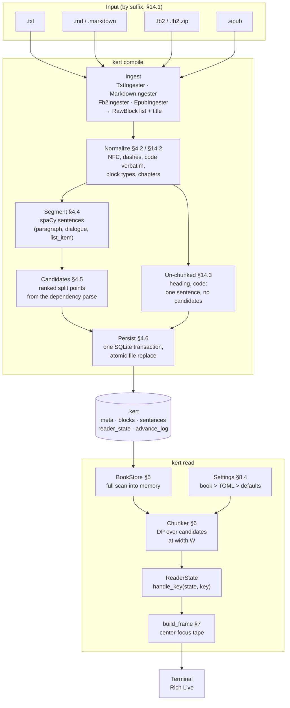
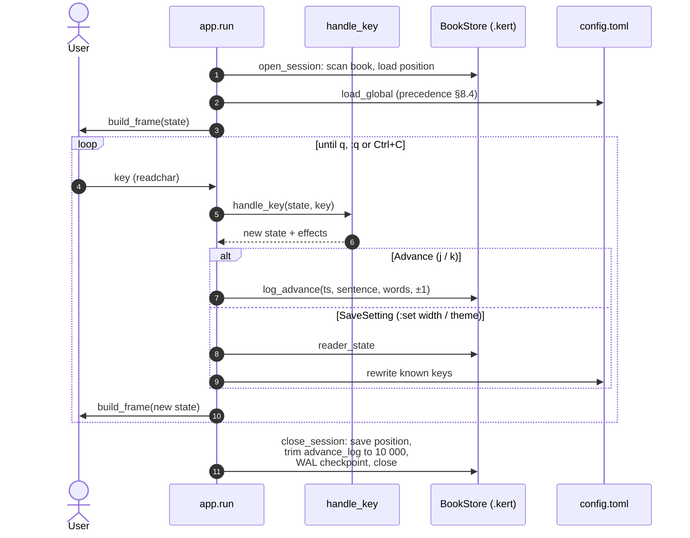
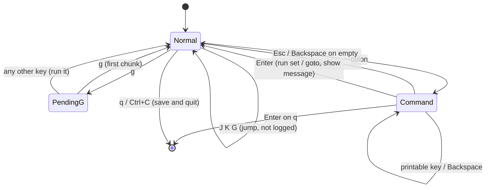
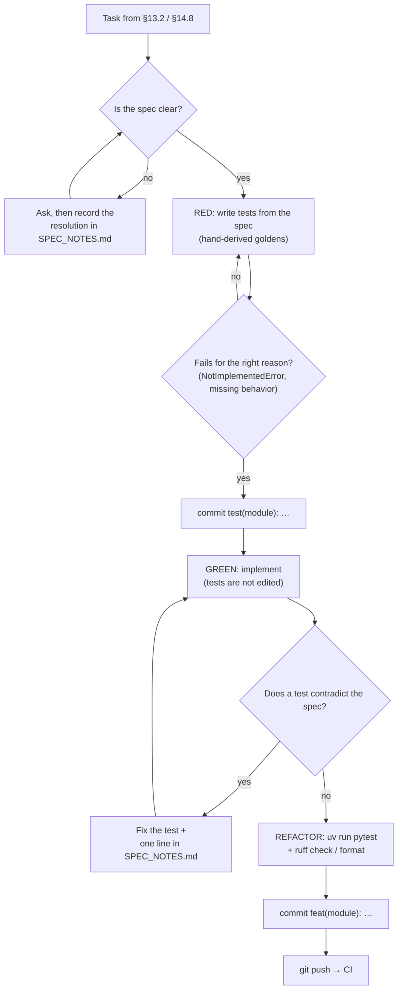
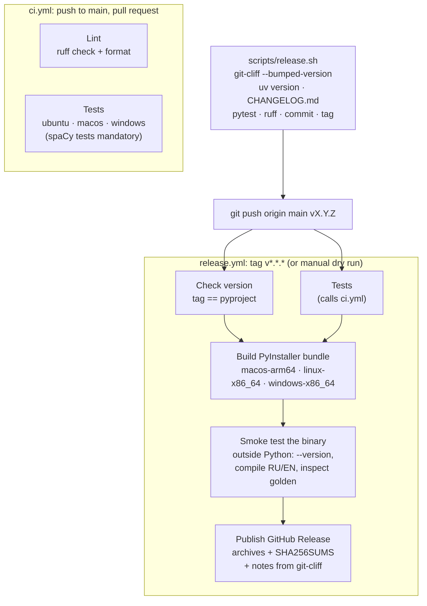

# kert: how it works

Four views of the project: data flow from a book file to the screen, the
Reader loop, the development workflow, and CI and release. The specification
(`kert_spec.md`) is the source of truth; section numbers below point into it.

## 1. Data flow: book file → `.kert` → screen

The Compiler and the Reader share only `common/` and the `.kert` file format.
The file stores split-point candidates, not finished fragments (D4), so the
Reader can re-chunk at any width without recompiling.

`kert inspect` reads the same `.kert` file and prints the candidates and
fragments as plain text. Use it to calibrate the §4.5 weights and §6 costs.

## 2. Reader loop

`handle_key` is pure: it returns a new state and a list of effects. The loop
in `app.py` performs the side effects: it writes `advance_log` rows and `:set`
values, and saves the position on exit.

## 3. Development workflow (strict TDD, §13.1)

Dependency changes are separate `chore(deps)` commits. Upgrading a model is
its own task, together with regenerating the goldens.

## 4. CI and release

Semantic versions come from conventional commits. While the major version is
0, `feat` bumps the minor version and `fix` bumps the patch version. `test:`,
`ci:` and release commits stay out of the changelog.
